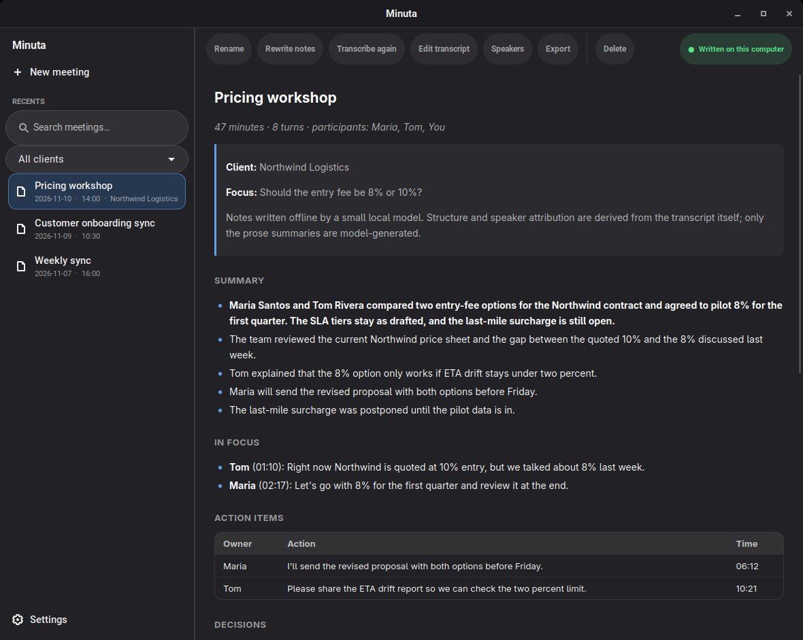
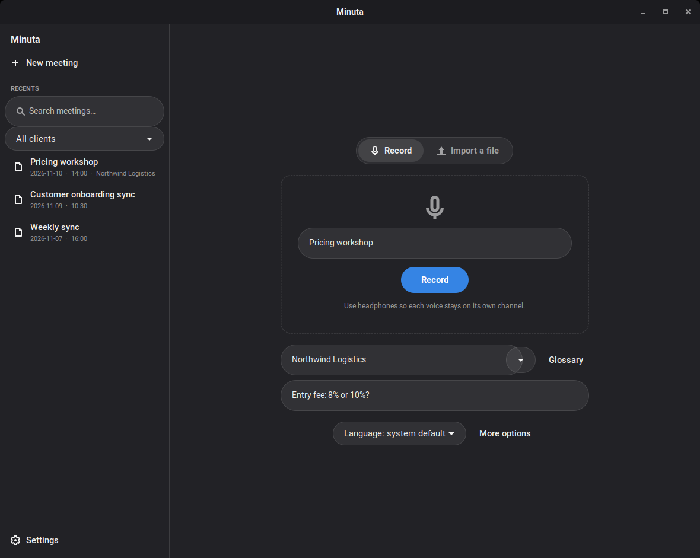
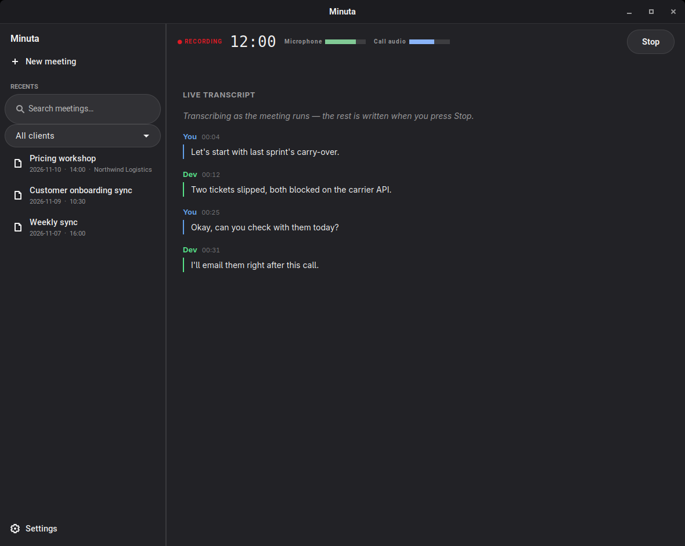
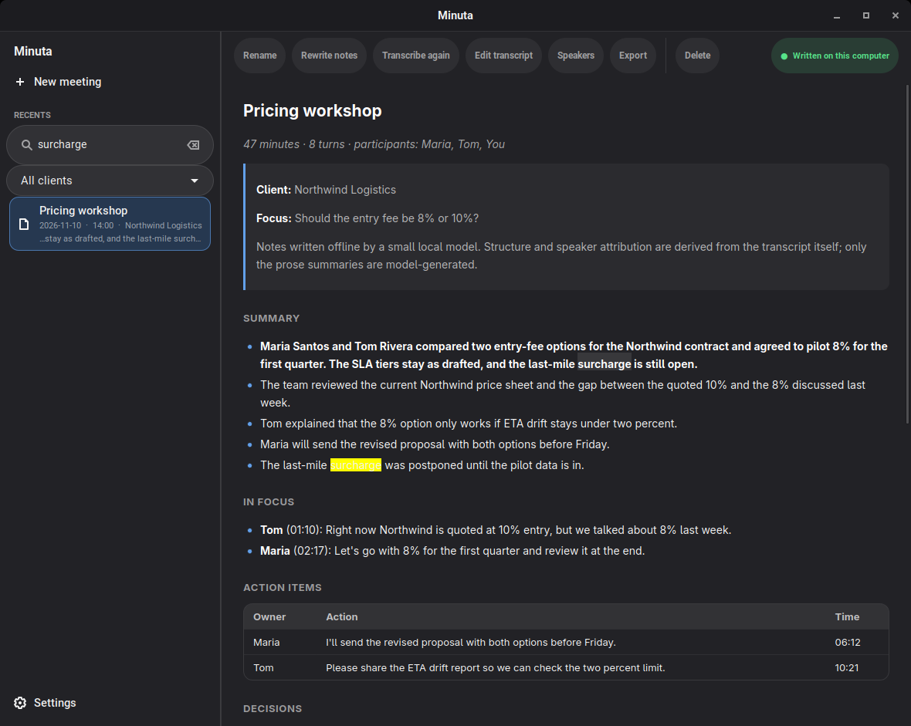
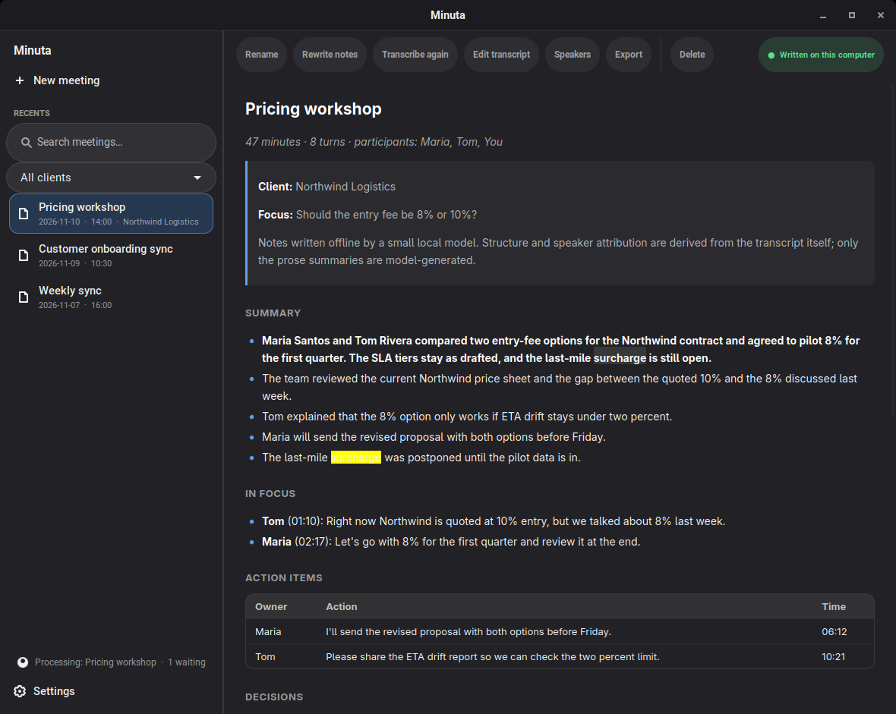
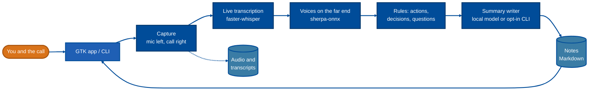
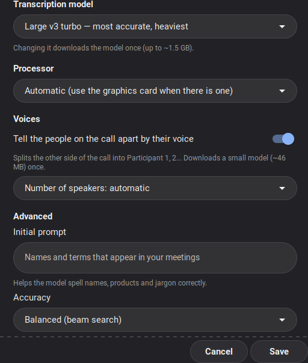

<div align="center">


# Minuta

**Record a meeting. Get the transcript and the minutes. Nothing leaves your computer.**

<sub>Formerly *MeetingInsights* — [what changed](#upgrading-from-meetinginsights)</sub>

[](LICENSE)
[](#install)
[](#privacy)
[](#requirements)

[Features](#features) · [How it works](#how-it-works) · [Install](#install) · [Use](#use) · [Obsidian](#obsidian) · [Settings](#settings) · [Privacy](#privacy)

🌐 **English** · [Português (Brasil)](README.pt-BR.md)

<br>



</div>

<br>

A Linux desktop app (GTK) and a command-line tool that turn a call into a transcript and
structured notes — a summary, **action items with owners**, decisions and open questions —
in the language of the meeting. Speech recognition and note writing run on your machine:
no account, no API key, no upload. Writing the notes with Claude Code or Gemini CLI is
possible, but it is off unless you turn it on.

## Features

|  |  |
|---|---|
| 🎙️ **Record or import** | Capture the microphone and the call audio together, or drop in any audio or video file. |
| ⚡ **Live transcription** | The transcript is built while the meeting runs, so stopping is nearly instant. |
| 🗂️ **Background queue** | Notes are written in the background: the window is free right after **Stop**, and you can start the next recording while the last one is still being processed. |
| 👥 **Who said what** | *You*, and each voice on the far end (*Participant 1, 2…*). |
| 📝 **Useful notes** | Summary with an overview, action items with owners, decisions, open questions. Portuguese and English. |
| 🎯 **Client and focus** | A saved **glossary** of names and terms per client, and a **focus** ("what matters in this meeting") that gets its own *In focus* section. |
| 🔊 **Input meters** | Live levels for the microphone and the call audio, with a warning when one of them goes quiet — a dead input is caught in seconds, not after the meeting. |
| 🟣 **Obsidian export** | Save a meeting as a note in your vault: frontmatter, a foldable transcript, a link back to the client's hub and a line in its index, so the note is reachable from the rest of the vault. |
| 🗒️ **Action items to Trello** | Turn a meeting's action items into Trello cards (owner, meeting and time in the description) with one click. Opt-in: nothing is sent until you choose items. |
| 🔎 **Search everything** | Find a meeting by what was said — in the notes *and* the transcript, ignoring case and accents — and filter by client. Matches are highlighted in the notes. |
| 🛟 **Crash recovery** | A recording cut short (crash, power loss) is finished on the next launch, and audio that never got notes is offered for processing. |
| 📤 **Export and edit** | Rename, rewrite the notes, transcribe again, edit the transcript, delete; export to Markdown, Word (`.docx`) or PDF. |
| 🧠 **Your choice of writer** | A small local model, a bigger local one, or — opt in — Claude Code / Gemini CLI. |

<table>
<tr>
<td width="50%"><br><sub><b>New meeting</b> — a title, an optional client (with its glossary) and a focus.</sub></td>
<td width="50%"><br><sub><b>Recording</b> — input meters and a live transcript.</sub></td>
</tr>
<tr>
<td width="50%"><br><sub><b>Search</b> — across notes and transcripts, with a client filter.</sub></td>
<td width="50%"><br><sub><b>Background queue</b> — the next recording can start while this one is processed.</sub></td>
</tr>
</table>

## How it works



| Part of the notes | Produced by |
|---|---|
| Transcript | faster-whisper, local, on the GPU when there is one |
| "You" vs. the far end | audio routing (separate channels) |
| *Participant 1, 2…* on the far end | offline speaker diarization (sherpa-onnx) |
| Questions, decisions, action items | pattern rules over the transcript (Portuguese and English) |
| Action-item owners | the speaker labels |
| **In focus** section | keyword match of your focus against the transcript |
| Prose summary | a local language model (small or medium), or Claude Code / Gemini CLI if you opt in |

**Why the speakers are reliable.** Your microphone is recorded to the left channel and
everything you hear to the right, and each channel is transcribed separately, so "You" is
exact. The far end shares one channel; a diarization model splits it by voice, cutting
where the voice changes. Action-item owners are read off those labels. The language model
is never asked who committed to what, so it cannot invent a participant.

**Why a tiny model can be enough.** Structure, classification and attribution are done in
code, and the model only writes the prose. In testing, moving classification out of the
model and into rules fixed every misclassification and cut runtime by ~75%. For richer
summaries choose the **medium** local model (3B): it also writes a short overview at the
top and writes in the language of the meeting, at about 4× the time on a CPU (roughly
5 minutes for an 11-minute meeting on 8 cores). Like any small model it can still get a
detail wrong, so read the notes before you share them.

## Requirements

- Linux with PulseAudio or PipeWire, `ffmpeg`, Python 3.9+
- A GPU is optional. Without one it runs on the CPU with the `small` model; with an NVIDIA
  GPU the installer adds the CUDA libraries and uses `large-v3-turbo`, which is several
  times faster (a 62-second recording takes about 4 s after the model loads).
- Disk: ~1.5 GB for the base models, plus ~1.6 GB for `large-v3-turbo`, ~2 GB for the
  medium summary model and ~46 MB for the diarization model — each downloaded once, only
  if you use it. About 650 MB of RAM while writing notes with the small model, about 3 GB
  with the medium one.

## Install

**Debian / Ubuntu** — download the `.deb` from the [latest release](https://github.com/bcocheto/minuta/releases/latest). The package bundles the llama.cpp runtime, so nothing has to be compiled:

```sh
sudo apt install ./minuta_<version>_amd64.deb
minuta setup      # prepares Python and downloads the models, once
```

**From source** (any distro):

```sh
git clone https://github.com/bcocheto/minuta && cd minuta
./install.sh               # installs to ~/.local
minuta setup
```

<details>
<summary>The source install needs llama.cpp, built once</summary>

```sh
git clone --depth 1 https://github.com/ggml-org/llama.cpp
cd llama.cpp && cmake -B build -DCMAKE_BUILD_TYPE=Release -DLLAMA_CURL=OFF
cmake --build build -j --target llama-app
mkdir -p ~/.local/share/minuta/llama
cp build/bin/llama build/bin/*.so* ~/.local/share/minuta/llama/
```

Upstream's prebuilt binaries require glibc 2.34, which rules out Ubuntu 20.04 and 22.04 —
which is why the `.deb` ships its own build.
</details>

### Upgrading from MeetingInsights

Minuta is the new name of MeetingInsights, with a new icon. Nothing is lost when you upgrade:

- **Package:** `sudo apt install ./minuta_<version>_amd64.deb` replaces the old `meetinginsights` package.
  **From source:** run `./install.sh` again; it removes the old program files and **keeps your data**.
- **Your data moves, once:** `~/.local/share/meetinginsights` → `~/.local/share/minuta` (models, Python
  environment, recordings) and `~/.config/meetinginsights` → `~/.config/minuta` (settings, clients). Your notes in
  `~/MeetingNotes` stay where they are.
- **Names:** the commands are now `minuta` and `minuta-gui`, and the variables `MINUTA_*` (the old
  `MEETINGINSIGHTS_*` still work). The application id is `io.github.bcocheto.Minuta`.

## Use

Open **Minuta** from the applications menu. In *New meeting* choose **Record**
(type a title, optionally a client and a focus) or **Import a file**. When you stop, the
notes appear in the list.

From the terminal:

```sh
minuta start "Weekly sync" --client "Acme" --focus "pricing: 8% or 10% down payment?"
minuta stop                       # transcribes, then writes the notes
minuta status

minuta import call.mp4 "Kickoff" --client "Acme"
minuta notes <transcript.txt>     # regenerate notes from a transcript
minuta reprocess <name> [--notes-only] [--client N] [--focus T]
minuta rename <name> "New title"
minuta toggle                                # start, or stop and write the notes (one key for both)
minuta shortcut set "<Super><Alt>r"          # make that a GNOME keyboard shortcut (also in Settings)
minuta speakers <name>                       # list the speakers
minuta speakers <name> "Speaker 2=Maria"     # rename them in the transcript and the notes
minuta export <name> <md|docx|pdf> [file] [--no-transcript]
minuta delete <name>
minuta obsidian <name> [--folder P] [--no-transcript]   # note in your Obsidian vault
minuta trello send <name> [--only 1,3] [--dry-run]       # action items to Trello cards
minuta search [--client N] words  # find meetings by what was said
minuta recover [--list]           # finish an interrupted recording
```

`<name>` is the file stem, e.g. `2026-11-09_14-36_weekly-sync`. Run `minuta help`
for the full list. `minuta stop --capture-only` saves the audio in a couple of
seconds and leaves the rest to `minuta finish <name>`; the app uses this to keep
the window free.

Notes land in `~/MeetingNotes/`; audio and transcripts in
`~/.local/share/minuta/rec/`.

### Clients and glossaries

A glossary is the names and terms a client uses (people, products, jargon). It is added to
the speech recognizer's prompt and given to the note writer, which fixes near-miss
spellings. In the app, type the client in *New meeting* and press **Glossary**; from the
CLI:

```sh
minuta client set "Acme" "Be In Rio, Lumière, own use, IA Zap"
minuta client list | show "Acme" | rm "Acme"
```

The *focus* is free text for one meeting. It steers the summary and fills the **In focus**
section with the lines of the transcript that mention it. It is not an instruction to the
transcriber; use the glossary or the *Initial prompt* setting for that.

### Obsidian

> Passo a passo em português: [README.pt-BR.md → Configurar o Obsidian](README.pt-BR.md#configurar-o-obsidian).

Point the app at your vault once, then export any meeting from **Export → Obsidian note** (the
app asks for the vault the first time) or with `minuta obsidian <name>`:

```sh
minuta config obsidian_vault ~/Documents/MyVault
minuta config obsidian_folder "Clients/{client}/Meetings"   # default: Meetings
```

The note is named `YYYY-MM-DD - Title.md`, with frontmatter (`type`, `created`, `updated`,
the date, client, participants, duration, `tags`, the source and the meeting id), the notes as
written, and the transcript in a foldable `[!note]-` callout (`--no-transcript` leaves it out).
Frontmatter keys follow the interface language (Portuguese or English). Exporting again updates
the same file; a note of yours that happens to have the same name is never overwritten, and
nothing is ever written outside the vault.

For each client you can also say where its meetings live and how to reach them:

```sh
minuta client config "Acme" folder "Clients/Acme/Meetings"
minuta client config "Acme" hub    "Clients/Acme/_HUB"          # linked at the top of the note
minuta client config "Acme" index  "Clients/Acme/Meetings/Index" # a row (or bullet) is added
```

These are also in the app, under **Glossary**. The index gets one new row if it has a table
(matching its columns) or one bullet otherwise, and its `updated:` date is refreshed; a meeting
already listed is not added twice.

### Action items to Trello

From the app: **Export → Send action items to Trello…**. The first time it asks you to connect
(an API key and a token) and to choose the board and list that should receive the cards; then you
tick the action items to send. Each card gets the action as its title and the owner, the meeting
(with date) and the time in the recording in its description. Items you already sent are marked and
never duplicated, even if you send the meeting again.

From the terminal:

```sh
minuta trello login               # asks for the API key and the token (the token is hidden)
minuta trello boards              # id <TAB> name
minuta trello lists <board-id>
minuta trello use <list-id> "Backlog"
minuta trello send <name> --dry-run          # show what would be created
minuta trello send <name> [--only 1,3]       # create the cards (all, or the chosen rows)
minuta trello logout
```

Create the key and the token yourself on <https://trello.com/power-ups/admin> (*New*, then *API key*;
the same page offers a *Token*). They are stored in `~/.config/minuta/trello`, readable only by
you, travel in the body of an HTTPS request (never in a URL) and are never shown in the process list.
Setting `MINUTA_TRELLO_KEY` and `MINUTA_TRELLO_TOKEN` instead keeps them out of any file.
Which items were already sent is remembered in `~/.local/share/minuta/rec/<name>.trello`.

## Settings

Open **Settings** in the app, or use `minuta config [key [value]]` and
`minuta language`.

<table>
<tr>
<td>

| Setting | Values | Default |
|---|---|---|
| Spoken language | `system` (follows the OS), `auto`, or a code such as `pt`, `en` | `system` |
| Transcription model | `small`, `medium`, `large-v3-turbo` | `large-v3-turbo` with GPU libraries, else `small` |
| Processor | `auto` (GPU when usable), `cpu` | `auto` |
| Who writes the notes | `local`, `claude-code`, `gemini-cli` | `local` |
| Local summary model | `notes_model`: `small` (0.5B, 0.5 GB) or `medium` (3B, 2 GB) | `small` |
| Tell voices apart | `diarize` on/off, `speakers` 0 (auto) to 8 | on |
| Initial prompt | names and jargon to help spelling (`prompt`, up to 500 characters) | empty |
| Accuracy | `beam` 1 (fast) to 10 | 5 |
| Obsidian vault / folder | `obsidian_vault` (path), `obsidian_folder` (inside the vault; `{client}` allowed) | unset / `Meetings` |
| Even out volume / threads | `normalize` on/off, `threads` 0 = auto | off / 0 |

</td>
<td width="260"></td>
</tr>
</table>

Environment variables override the settings file (`~/.config/minuta/config`):

| Variable | Meaning |
|---|---|
| `MINUTA_OUT` | where notes are written (default `~/MeetingNotes`) |
| `MINUTA_HOME` | where models, audio and transcripts live |
| `MINUTA_WHISPER_MODEL` | transcription model |
| `MINUTA_LLM_MODEL` | any GGUF chat model for the local note writer |
| `MINUTA_YOU` / `MINUTA_THEM` | channel labels |
| `MINUTA_LIVE` | `0` turns off live transcription |

## Privacy

- Audio, transcripts and notes stay on your machine, in folders only your user can read.
- Models are downloaded once, during `setup` (or the first use of a new model). After that
  the transcriber loads them from disk and makes no network calls.
- **Trello (opt-in, on request):** only when you choose *Send action items to Trello* does the app talk to
  Trello, and it sends just the text of the items you ticked and the meeting title.
- **Opt-in exception:** if you pick `claude-code` or `gemini-cli` as the note writer, the
  **transcript is sent to that service** to write the notes. The app uses the CLI you
  already have installed and logged in, and never sees your credentials. Notes written
  this way say so at the top, and the app marks them with a cloud badge. Leave the setting
  on `local` to keep everything offline.

> **Recording consent.** Recording a conversation without telling the other participants is
> illegal in many places. `minuta start` prints a reminder; please honour it.

## Development

```sh
python3 -m unittest discover -s tests
```

Covers note classification, focus matching, search, Obsidian export, Trello (against a local fake server), the external writer, input levels, the CLI
(glossaries, interrupted recordings, renames) and word error rate. To guard transcription
quality when you change the pipeline, point the end-to-end test at a recording and its
reference text:

```sh
MI_E2E_AUDIO=talk.wav MI_E2E_REFERENCE=talk.txt MI_E2E_MAX_WER=0.20 \
  ~/.local/share/minuta/venv/bin/python -m unittest tests.test_e2e
```

The screenshots in this README are generated from made-up demo data (nothing from real
meetings): `GDK_BACKEND=x11 python3 packaging/screenshots.py`.

## Licence

MIT — see [`LICENSE`](LICENSE).

## Links

- Source: https://github.com/bcocheto/minuta
- Minuta started as a fork of [techbysaurabh/meetinginsights-linux](https://github.com/techbysaurabh/meetinginsights-linux)
  (MIT) and keeps that licence notice. The name, the icon and most of the code since are new.
- Formerly *MeetingInsights*: settings and data are moved over automatically the first time `minuta` runs.
