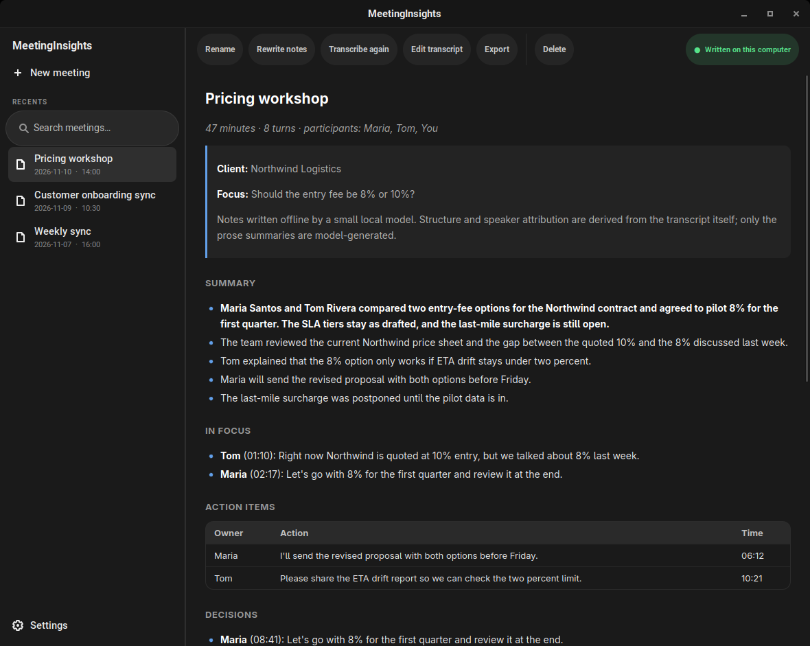
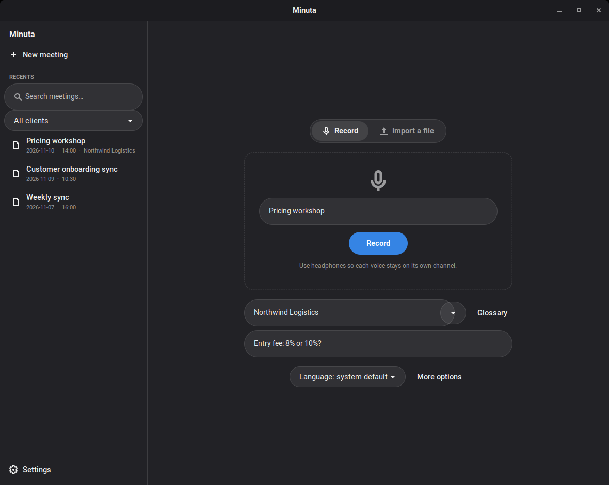
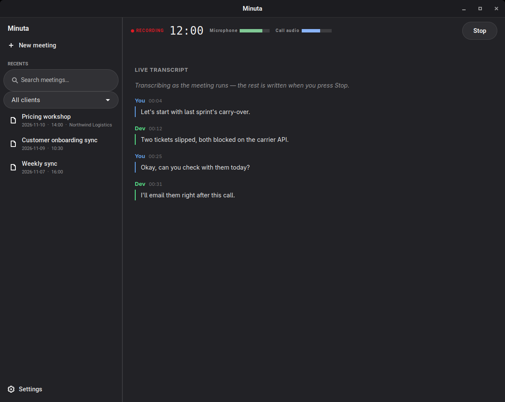
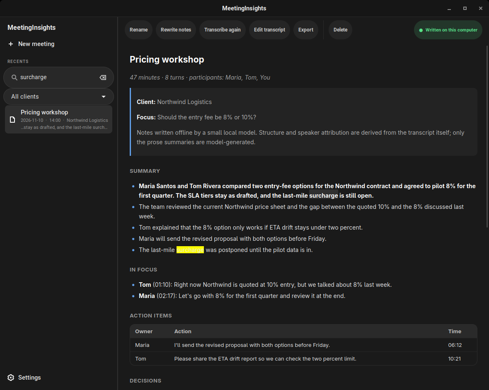
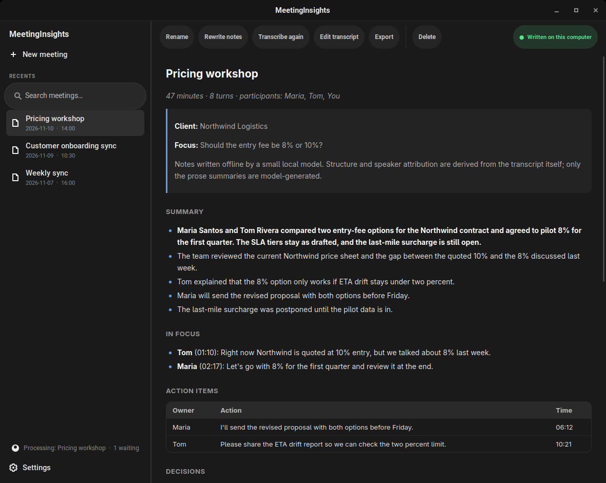
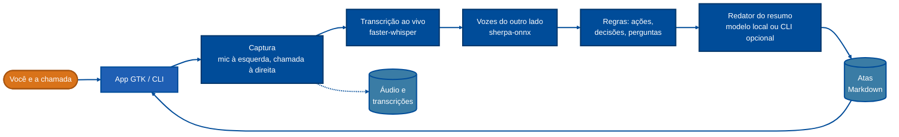
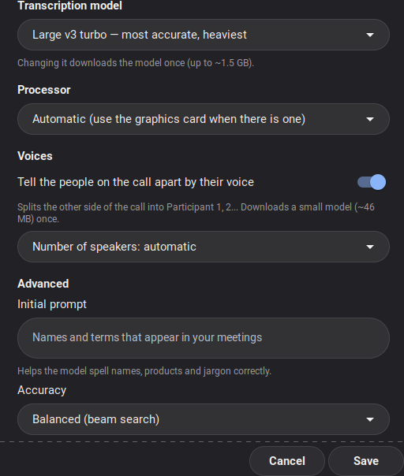

<div align="center">


# Minuta

**Grave uma reunião. Receba a transcrição e a ata. Nada sai do seu computador.**

<sub>Antes chamada de *MeetingInsights*: [o que mudou](#atualizando-do-meetinginsights)</sub>

[](LICENSE)
[](#instalação)
[](#privacidade)
[](#requisitos)

[Recursos](#recursos) · [Como funciona](#como-funciona) · [Instalação](#instalação) · [Uso](#uso) · [Configurar o Obsidian](#configurar-o-obsidian) · [Configurações](#configurações) · [Privacidade](#privacidade)

🌐 **Português (Brasil)** · [English](README.md)

<br>



<sub>As capturas de tela mostram a interface em inglês, com dados fictícios. O app segue o idioma do seu sistema.</sub>

</div>

<br>

Um aplicativo de desktop para Linux (GTK) e uma ferramenta de linha de comando que
transformam uma chamada em transcrição e ata estruturada: resumo, **itens de ação com
responsável**, decisões e perguntas em aberto, no idioma da reunião. O reconhecimento de fala
e a escrita da ata rodam na sua máquina: sem conta, sem chave de API, sem envio de dados.
Escrever a ata com o Claude Code ou o Gemini CLI é possível, mas fica desligado até você ligar.

## Recursos

|  |  |
|---|---|
| 🎙️ **Gravar ou importar** | Capture o microfone e o áudio da chamada juntos, ou importe qualquer arquivo de áudio ou vídeo. |
| ⚡ **Transcrição ao vivo** | A transcrição é feita enquanto a reunião acontece, então parar a gravação é quase instantâneo. |
| 🗂️ **Fila em segundo plano** | A ata é escrita em segundo plano: a janela fica livre logo depois do **Parar**, e dá para começar a próxima gravação enquanto a anterior ainda é processada. |
| 👥 **Quem disse o quê** | *Você* e cada voz do outro lado (*Participante 1, 2…*). |
| 📝 **Atas úteis** | Resumo com uma visão geral, itens de ação com responsável, decisões e perguntas em aberto. Português e inglês. |
| 🎯 **Cliente e foco** | Um **glossário** salvo de nomes e termos por cliente, e um **foco** ("o que importa nesta reunião") que ganha uma seção própria, *Em foco*. |
| 🔊 **Medidores de áudio** | Níveis ao vivo do microfone e do áudio da chamada, com aviso quando um deles fica em silêncio: uma entrada morta é percebida em segundos, não depois da reunião. |
| 🟣 **Exportação para o Obsidian** | Salve uma reunião como nota no seu vault: frontmatter, transcrição dobrável, link para o hub do cliente e uma linha no índice, para a nota ser alcançável a partir do resto do vault. |
| 🗒️ **Itens de ação para o Trello** | Transforme os itens de ação de uma reunião em cartões do Trello (responsável, reunião e hora na descrição) com um clique. Opcional: nada é enviado até você escolher os itens. |
| 🔎 **Busca em tudo** | Encontre uma reunião pelo que foi dito, nas notas *e* na transcrição, ignorando maiúsculas e acentos, e filtre por cliente. O trecho encontrado fica destacado na ata. |
| 🛟 **Recuperação de falhas** | Uma gravação interrompida (travamento, queda de energia) é concluída na próxima abertura, e áudios que ficaram sem ata são oferecidos para processamento. |
| 📤 **Exportar e editar** | Renomear, reescrever a ata, transcrever de novo, editar a transcrição, excluir; exportar para Markdown, Word (`.docx`) ou PDF. |
| 🧠 **Você escolhe quem escreve** | Um modelo local pequeno, um local maior ou, se você optar, o Claude Code / Gemini CLI. |

<table>
<tr>
<td width="50%"><br><sub><b>Nova reunião</b>: um título, um cliente opcional (com o glossário dele) e um foco.</sub></td>
<td width="50%"><br><sub><b>Gravando</b>: medidores de áudio e transcrição ao vivo.</sub></td>
</tr>
<tr>
<td width="50%"><br><sub><b>Busca</b>: nas notas e nas transcrições, com filtro de cliente.</sub></td>
<td width="50%"><br><sub><b>Fila em segundo plano</b>: a próxima gravação pode começar enquanto esta é processada.</sub></td>
</tr>
</table>

## Como funciona



| Parte da ata | Produzida por |
|---|---|
| Transcrição | faster-whisper, local, na GPU quando houver |
| "Você" x o outro lado | roteamento do áudio (canais separados) |
| *Participante 1, 2…* do outro lado | diarização de voz offline (sherpa-onnx) |
| Perguntas, decisões, itens de ação | regras de padrões sobre a transcrição (português e inglês) |
| Responsáveis pelos itens de ação | os rótulos de quem falou |
| Seção **Em foco** | busca por palavras-chave do seu foco na transcrição |
| Resumo em texto | um modelo de linguagem local (pequeno ou médio), ou Claude Code / Gemini CLI se você optar |

**Por que a identificação de quem falou é confiável.** O seu microfone é gravado no canal
esquerdo e tudo que você ouve no direito, e cada canal é transcrito separadamente, então
"Você" é exato. O outro lado compartilha um único canal; um modelo de diarização o separa por
voz, cortando no momento em que a voz muda. Os responsáveis pelos itens de ação são lidos
desses rótulos. O modelo de linguagem nunca é perguntado sobre quem se comprometeu com o quê,
então ele não consegue inventar um participante.

**Por que um modelo pequeno pode bastar.** Estrutura, classificação e atribuição são feitas
em código, e o modelo só escreve o texto corrido. Nos testes, tirar a classificação do modelo
e passá-la para regras eliminou todos os erros de classificação e reduziu o tempo em ~75%.
Para resumos mais ricos, escolha o modelo local **médio** (3B): ele também escreve uma breve
visão geral no topo e escreve no idioma da reunião, em cerca de 4 vezes o tempo numa CPU
(aproximadamente 5 minutos para uma reunião de 11 minutos, em 8 núcleos). Como todo modelo
pequeno, ele ainda pode errar um detalhe: leia a ata antes de compartilhar.

## Requisitos

- Linux com PulseAudio ou PipeWire, `ffmpeg`, Python 3.9+
- A GPU é opcional. Sem ela, roda na CPU com o modelo `small`; com uma GPU NVIDIA, o
  instalador adiciona as bibliotecas CUDA e usa o `large-v3-turbo`, que é várias vezes mais
  rápido (uma gravação de 62 segundos leva cerca de 4 s depois que o modelo carrega).
- Disco: ~1,5 GB para os modelos básicos, mais ~1,6 GB para o `large-v3-turbo`, ~2 GB para o
  modelo de resumo médio e ~46 MB para o modelo de diarização, cada um baixado uma vez e só
  se você usar. Cerca de 650 MB de RAM ao escrever a ata com o modelo pequeno e cerca de 3 GB
  com o médio.

## Instalação

**Debian / Ubuntu**: baixe o `.deb` da [última release](https://github.com/bcocheto/minuta/releases/latest). O pacote já traz o llama.cpp, então não é preciso compilar nada:

```sh
sudo apt install ./minuta_<versão>_amd64.deb
minuta setup      # prepara o Python e baixa os modelos, uma vez
```

**A partir do código-fonte** (qualquer distribuição):

```sh
git clone https://github.com/bcocheto/minuta && cd minuta
./install.sh               # instala em ~/.local
minuta setup
```

<details>
<summary>A instalação pelo código-fonte precisa do llama.cpp, compilado uma vez</summary>

```sh
git clone --depth 1 https://github.com/ggml-org/llama.cpp
cd llama.cpp && cmake -B build -DCMAKE_BUILD_TYPE=Release -DLLAMA_CURL=OFF
cmake --build build -j --target llama-app
mkdir -p ~/.local/share/minuta/llama
cp build/bin/llama build/bin/*.so* ~/.local/share/minuta/llama/
```

Os binários prontos do projeto original exigem a glibc 2.34, o que exclui o Ubuntu 20.04 e o
22.04. Por isso o `.deb` traz a própria compilação.
</details>

### Flatpak (em andamento)

Em `packaging/flatpak/` estão o manifesto e o arquivo AppStream para o Flathub. Para compilar e testar localmente:

```sh
flatpak run org.flatpak.Builder --user --install --force-clean --disable-rofiles-fuse build-flatpak packaging/flatpak/io.github.bcocheto.Minuta.yml
flatpak run io.github.bcocheto.Minuta
```

O Flatpak transcreve na CPU (sem as bibliotecas da NVIDIA), guarda as atas em `Documentos/Minuta` e não consegue usar o comando `claude` ou `gemini` do seu sistema.

### Atualizando do MeetingInsights

A Minuta é o novo nome do MeetingInsights, com um ícone novo. Nada se perde na atualização:

- **Pacote:** `sudo apt install ./minuta_<versão>_amd64.deb` substitui o pacote antigo `meetinginsights`.
  **Pelo código-fonte:** rode o `./install.sh` de novo; ele remove os arquivos antigos do programa e **mantém os seus dados**.
- **Os dados são movidos, uma vez:** `~/.local/share/meetinginsights` → `~/.local/share/minuta` (modelos,
  ambiente Python, gravações) e `~/.config/meetinginsights` → `~/.config/minuta` (configurações, clientes). As suas atas em
  `~/MeetingNotes` ficam onde estão.
- **Nomes:** os comandos agora são `minuta` e `minuta-gui`, e as variáveis, `MINUTA_*` (as antigas
  `MEETINGINSIGHTS_*` continuam valendo). O identificador do app é `io.github.bcocheto.Minuta`.

## Uso

Abra o **Minuta** no menu de aplicativos. Em *Nova reunião*, escolha **Gravar**
(digite um título e, se quiser, um cliente e um foco) ou **Importar um arquivo**. Quando você
parar, a ata aparece na lista.

No terminal:

```sh
minuta start "Alinhamento semanal" --client "Acme" --focus "preço: entrada de 8% ou 10%?"
minuta stop                       # transcreve e depois escreve a ata
minuta status

minuta import ligacao.mp4 "Kickoff" --client "Acme"
minuta notes <transcricao.txt>    # gera a ata de novo a partir de uma transcrição
minuta reprocess <nome> [--notes-only] [--client N] [--focus T]
minuta rename <nome> "Novo título"
minuta toggle                                # inicia, ou para e escreve a ata (uma tecla para os dois)
minuta shortcut set "<Super><Alt>r"          # vira um atalho de teclado do GNOME (também em Configurações)
minuta speakers <nome>                       # lista os falantes
minuta speakers <nome> "Speaker 2=Maria"     # renomeia na transcrição e na ata
minuta export <nome> <md|docx|pdf> [arquivo] [--no-transcript]
minuta delete <nome>
minuta obsidian <nome> [--folder P] [--no-transcript]   # nota no seu vault do Obsidian
minuta trello send <nome> [--only 1,3] [--dry-run]       # itens de ação viram cartões do Trello
minuta search [--client N] palavras  # encontra reuniões pelo que foi dito
minuta recover [--list]           # conclui uma gravação interrompida
```

`<nome>` é o nome do arquivo sem a extensão, por exemplo `2026-11-09_14-36_alinhamento-semanal`.
Rode `minuta help` para ver a lista completa. O comando
`minuta stop --capture-only` salva o áudio em alguns segundos e deixa o resto para
`minuta finish <nome>`; o app usa isso para manter a janela livre.

As atas ficam em `~/MeetingNotes/`; o áudio e as transcrições, em
`~/.local/share/minuta/rec/`.

### Clientes e glossários

O glossário é o conjunto de nomes e termos que um cliente usa (pessoas, produtos, jargão). Ele
é incluído no prompt do reconhecedor de fala e entregue ao redator da ata, que corrige grafias
aproximadas. No app, digite o cliente em *Nova reunião* e clique em **Glossário**; pela linha
de comando:

```sh
minuta client set "Acme" "Be In Rio, Lumière, uso próprio, IA Zap"
minuta client list | show "Acme" | rm "Acme"
```

O *foco* é um texto livre para uma reunião. Ele orienta o resumo e preenche a seção **Em foco**
com as falas da transcrição que o mencionam. Não é uma instrução para o transcritor: para isso,
use o glossário ou a configuração *Prompt inicial*.

## Configurar o Obsidian

O Minuta salva uma reunião como uma nota Markdown dentro do seu vault. O vault é só
uma pasta de arquivos, então o app apenas escreve arquivos, e **nunca fora do vault**.

### Passo a passo

**1. Escolha o vault (uma vez).** Pelo app, abra uma reunião e use **Exportar → Nota no
Obsidian**: na primeira vez, ele pergunta qual é a pasta do vault. Ou pelo terminal:

```sh
minuta config obsidian_vault ~/Documentos/MeuVault
```

O caminho precisa ser uma pasta que já exista. Para trocar de vault depois, use **Exportar →
Escolher o vault do Obsidian…** ou rode o comando acima de novo.

**2. Defina a pasta das notas.** Por padrão, as notas vão para a pasta `Meetings` do vault.
Você pode usar `{client}` para separar por cliente:

```sh
minuta config obsidian_folder "Clientes/{client}/Reuniões"
```

A pasta é sempre relativa ao vault. Reuniões sem cliente vão para `Clientes/Inbox/Reuniões`
neste exemplo, ou seja, `{client}` vira `Inbox`.

**3. (Opcional) Configure cada cliente.** Para dizer onde as reuniões de um cliente ficam e
como chegar a elas a partir do resto do vault, use as três opções abaixo. Elas também estão no
app, no botão **Glossário**, em *No seu vault do Obsidian*:

```sh
minuta client config "Acme" folder "Clientes/Acme/Reuniões"
minuta client config "Acme" hub    "Clientes/Acme/_HUB"               # linkado no topo da nota
minuta client config "Acme" index  "Clientes/Acme/Reuniões/_Índice"   # ganha uma linha por reunião
```

| Opção | O que faz |
|---|---|
| `folder` | Pasta das reuniões desse cliente (vale mais do que `obsidian_folder`). |
| `hub` | Nota para a qual a reunião aponta, com `Hub: [[…]]` no topo. Só aí o cliente vira um link `[[ ]]`, para não criar notas "fantasma" no grafo. |
| `index` | Nota que lista as reuniões. Se ela tiver uma tabela, entra uma linha nova com as mesmas colunas; senão, entra um item de lista. O campo `updated:` dela é atualizado, e uma reunião já listada não entra duas vezes. |

Todos os caminhos são relativos ao vault, sem `.md` no final e sem `..`.

**4. Associe o cliente à reunião.** A exportação usa o cliente guardado na reunião. Informe-o ao
gravar ou importar (`--client "Acme"`, ou o campo *Cliente* em *Nova reunião*). Numa reunião
antiga, associe-o e reescreva a ata (isso substitui a ata atual):

```sh
minuta reprocess <nome> --notes-only --client "Acme"
```

**5. Exporte.** No app, **Exportar → Nota no Obsidian**. No terminal:

```sh
minuta obsidian <nome>                    # transcrição incluída, em bloco dobrável
minuta obsidian <nome> --no-transcript    # só a ata
minuta obsidian <nome> --folder "Inbox"   # pasta só desta vez
```

O comando imprime o caminho da nota criada (e "added to the index" quando o índice foi
atualizado).

### Como fica a nota

O arquivo se chama `AAAA-MM-DD - Título.md`. As chaves do frontmatter seguem o idioma da
interface (aqui, português):

```markdown
---
type: reuniao
created: 2026-11-10
updated: 2026-11-10
data: 2026-11-10
cliente: "Acme"
participantes: [Maria, Tom]
duration_min: 47
tags: [reuniao, minuta, acme]
fonte: Minuta (transcrição automática; confira antes de agir)
meeting: 2026-11-10_14-00_alinhamento-semanal
---

# Alinhamento semanal

Hub: [[Clientes/Acme/_HUB|Acme]]

*47 minutos · 8 falas · participantes: Maria, Tom*

## Resumo
…
## Itens de ação
…

> [!note]- Transcrição
> [00:05] Maria: Obrigada a todos por entrarem…
```

Em inglês, as chaves viram `type: meeting`, `date`, `client` e `participants`.

### Boas práticas e solução de problemas

- **Exportar de novo atualiza a mesma nota.** O campo `meeting:` identifica a reunião. Se já
  existir uma nota *sua* com o mesmo nome, ela nunca é sobrescrita: a nova ganha " (2)".
- **Confira a ata antes de agir.** O texto vem de transcrição automática e de um modelo
  pequeno, e a nota avisa isso na propriedade `fonte`.
- **`no vault set`**: nenhum vault configurado. Rode o passo 1.
- **`not a folder`**: o caminho do vault não existe ou não é uma pasta.
- **`is outside the vault`**: a pasta pedida tenta sair do vault (por exemplo, com `..`). Um
  caminho absoluto é lido como relativo ao vault.
- **A nota não aparece no grafo ligada a nada**: configure o `hub` e o `index` do cliente
  (passo 3). Sem isso, a nota existe, mas nada aponta para ela.
- Se o seu vault usa outras convenções de frontmatter, edite as notas depois: o Minuta
  só cria e atualiza o arquivo que ele mesmo gerou.

## Itens de ação para o Trello

Pelo app: **Exportar → Enviar itens de ação ao Trello…**. Na primeira vez, ele pede para conectar
(uma chave de API e um token) e para escolher o quadro e a lista que vão receber os cartões; depois,
você marca os itens que quer enviar. Cada cartão leva a ação como título e, na descrição, o
responsável, a reunião (com a data) e a hora na gravação. Os itens já enviados aparecem marcados e
nunca são duplicados, mesmo que você envie a reunião de novo.

Pelo terminal:

```sh
minuta trello login               # pede a chave de API e o token (o token fica oculto)
minuta trello boards              # id <TAB> nome
minuta trello lists <id-do-quadro>
minuta trello use <id-da-lista> "Backlog"
minuta trello send <nome> --dry-run          # mostra o que seria criado
minuta trello send <nome> [--only 1,3]       # cria os cartões (todos, ou só as linhas escolhidas)
minuta trello logout
```

Crie a chave e o token você mesmo em <https://trello.com/power-ups/admin> (*New*, depois *API key*; a
mesma página oferece o *Token*). Eles ficam em `~/.config/minuta/trello`, legível só por você,
viajam no corpo de uma requisição HTTPS (nunca numa URL) e não aparecem na lista de processos. Definir
`MINUTA_TRELLO_KEY` e `MINUTA_TRELLO_TOKEN` mantém os dois fora de qualquer arquivo.
Os itens já enviados ficam registrados em `~/.local/share/minuta/rec/<nome>.trello`.

**Dica:** para o Trello receber o texto certo, confira a ata antes. Os itens de ação são extraídos
por regras sobre a transcrição e podem conter falhas de transcrição.

## Configurações

Abra **Configurações** no app, ou use `minuta config [chave [valor]]` e
`minuta language`.

<table>
<tr>
<td>

| Configuração | Valores | Padrão |
|---|---|---|
| Idioma falado | `system` (segue o sistema), `auto`, ou um código como `pt`, `en` | `system` |
| Modelo de transcrição | `small`, `medium`, `large-v3-turbo` | `large-v3-turbo` com as bibliotecas de GPU, senão `small` |
| Processador | `auto` (GPU quando der), `cpu` | `auto` |
| Quem escreve a ata | `local`, `claude-code`, `gemini-cli` | `local` |
| Modelo local do resumo | `notes_model`: `small` (0,5B, 0,5 GB) ou `medium` (3B, 2 GB) | `small` |
| Distinguir as vozes | `diarize` ligado/desligado, `speakers` 0 (auto) a 8 | ligado |
| Prompt inicial | nomes e jargão para ajudar na grafia (`prompt`, até 500 caracteres) | vazio |
| Precisão | `beam` de 1 (rápido) a 10 | 5 |
| Vault / pasta do Obsidian | `obsidian_vault` (caminho), `obsidian_folder` (dentro do vault; aceita `{client}`) | vazio / `Meetings` |
| Nivelar o volume / threads | `normalize` ligado/desligado, `threads` 0 = automático | desligado / 0 |

</td>
<td width="260"></td>
</tr>
</table>

As variáveis de ambiente prevalecem sobre o arquivo de configurações
(`~/.config/minuta/config`):

| Variável | Significado |
|---|---|
| `MINUTA_OUT` | onde as atas são gravadas (padrão `~/MeetingNotes`) |
| `MINUTA_HOME` | onde ficam os modelos, o áudio e as transcrições |
| `MINUTA_WHISPER_MODEL` | modelo de transcrição |
| `MINUTA_LLM_MODEL` | qualquer modelo de chat GGUF para o redator local |
| `MINUTA_YOU` / `MINUTA_THEM` | rótulos dos canais |
| `MINUTA_LIVE` | `0` desliga a transcrição ao vivo |

## Privacidade

- O áudio, as transcrições e as atas ficam na sua máquina, em pastas que só o seu usuário lê.
- Os modelos são baixados uma vez, durante o `setup` (ou no primeiro uso de um modelo novo).
  Depois disso, o transcritor os carrega do disco e não faz chamadas de rede.
- **Exceção opcional:** se você escolher `claude-code` ou `gemini-cli` para escrever a ata, a
  **transcrição é enviada a esse serviço** para a ata ser escrita. O app usa a CLI que você já
  tem instalada e autenticada e nunca vê as suas credenciais. As atas escritas assim avisam no
  topo, e o app as marca com um selo de nuvem. Deixe a configuração em `local` para manter
  tudo offline.
- **Trello (opcional, sob demanda):** só quando você escolhe *Enviar itens de ação ao Trello* o app fala com o
  Trello, e ele envia apenas o texto dos itens marcados e o título da reunião.
- **Obsidian:** a exportação só escreve arquivos dentro da pasta do vault que você escolheu.

> **Consentimento para gravar.** Gravar uma conversa sem avisar os outros participantes é
> ilegal em muitos lugares. O `minuta start` imprime um lembrete; respeite-o.

## Desenvolvimento

```sh
python3 -m unittest discover -s tests
```

Cobre a classificação das falas, o foco, a busca, a exportação para o Obsidian, o Trello (contra um servidor falso local), o redator
externo, os níveis de áudio, a CLI (glossários, gravações interrompidas, renomeações) e a taxa
de erro de palavras. Para proteger a qualidade da transcrição ao mexer no pipeline, aponte o
teste de ponta a ponta para uma gravação e o texto de referência dela:

```sh
MI_E2E_AUDIO=fala.wav MI_E2E_REFERENCE=fala.txt MI_E2E_MAX_WER=0.20 \
  ~/.local/share/minuta/venv/bin/python -m unittest tests.test_e2e
```

As capturas de tela deste README são geradas a partir de dados fictícios (nada de reuniões
reais): `GDK_BACKEND=x11 python3 packaging/screenshots.py`.

## Licença

MIT. Veja o [`LICENSE`](LICENSE).

## Links

- Código-fonte: https://github.com/bcocheto/minuta
- A Minuta nasceu de um fork de [techbysaurabh/meetinginsights-linux](https://github.com/techbysaurabh/meetinginsights-linux)
  (MIT) e mantém o aviso dessa licença. O nome, o ícone e a maior parte do código desde então são novos.
- Antes se chamava *MeetingInsights*: as configurações e os dados são movidos automaticamente na primeira vez que o `minuta` roda.
